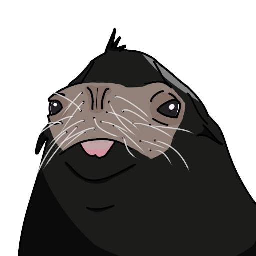

# Seal Engine

Seal Engine is a from-scratch, clean-room, AI-native game engine.

This repository is the public home of Seal. The project is early: the design is decided, and the engine source is not in the tree yet. What follows is the plan we are building toward, not a list of features you can run today.

## What Seal is

Seal is a complete game engine written as original work, with a stable native API and an AI-first workflow.

### Languages and API

The core is Rust, with a stable, versioned C ABI so other languages and native libraries can talk to the engine. Rust and C++ types are first-class through one reflection registry.

### AI-native

Seal is built so people, scripts, and agents use the same capabilities. The engine includes an MCP server, so AI agents can drive the editor and the runtime.

### SealText

Assets and scenes are stored as SealText, a human-readable text format with the `.seal` extension. Text comes first, so files are reviewable, diffable, and easy for both humans and agents to edit.

### Scripting

Gameplay can be written as:

- Wasm modules, in any language
- visual-script graphs, compiled ahead of time to Rust
- resumable state-machine flows

### Renderer

The renderer is native Vulkan. Shaders are written in Slang. Bindless resources are used where the backend allows it.

### Runtime

Seal uses its own allocator, and a fiber and job system designed for deterministic replay.

### Physics

Rapier is the physics engine, with Jolt available through the C ABI. The query API includes collision channels and traces.

### Audio

A Rust mixer, based on cpal, is the default. FMOD can be added as an optional plugin.

### Text and localization

Localized messages use Fluent. Text shaping uses HarfBuzz or a Rust port. UI text is drawn from a glyph atlas, with MSDF for scalable UI type.

### UI

The editor and the runtime have separate UI frameworks. Layout uses taffy. Accessibility is provided through AccessKit.

### Assets and mods

Cooked assets are stored in a content-addressed format and compressed with zstd. A virtual filesystem supports overlay mounts. Overrides are keyed by stable ids and can be field-level patches, so a mod can change part of an asset without replacing the whole file. Large binaries are kept in Git LFS.

### Quality

Nightly fuzzing and snapshot/replay tests are part of the plan, so behavior stays deterministic and regressions are caught early.

## Goals

- A complete, fast, and deterministic engine.
- An AI-first workflow, from the editor to headless and CI runs.
- A strong modding foundation. Modding is encouraged. If a product obfuscates or protects its code, its modding tools may be restricted or removed.
- A pipeline that is straightforward to adopt.
- Accessibility in the runtime UI from the start.
- Clean-room legality from day one. Contributions and engine code must be original work, not copied from other engines or from projects whose licenses do not allow it.
- Full documentation, with an mdBook manual planned in this repository.

These are planned as well, and are not foundation blockers:

- Optional, replaceable pre-built gameplay modules, such as inventory, crafting, and chests.
- An easy rich-text dialogue editor.
- One-click source-control setup.

## Status and license

Seal source code is, or will be, publicly viewable in this repository, but Seal is **not open source**. Reading the code does not grant any right beyond the [license](LICENSE.md).

A short summary of the terms (the license is the authority if anything is unclear):

- A Product owes **4%** of its Gross Revenue above **US$250,000** lifetime per Product.
- Modding is encouraged.
- Seal does not include copyleft-licensed dependencies. A copyleft dependency is a bug and will be removed.

See [LICENSE.md](LICENSE.md) for the full terms, including royalty reporting, the audit right, source-sharing rules, contributions, and trademarks.

Contact: [seal@poplocorp.com](mailto:seal@poplocorp.com).

## Contributions

Patches and other contributions may be sent to this repository. By sending a contribution, you license it to the Licensor as described in section 9 of [LICENSE.md](LICENSE.md).

A contribution must be written by you, or generated under Seal's agent rules, and must not copy code from any other engine or from any project whose license does not allow it. Seal is developed as a clean room from the start. The Licensor may reject, revert, or rewrite any contribution that looks copied or too similar to existing code.

Copyright (c) 2026 404poplopop. All rights reserved except as granted in LICENSE.md.
